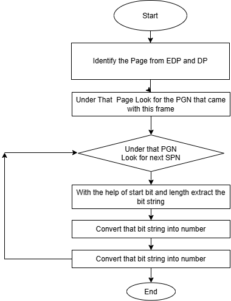

# How Data is defined and decoded in J1939

* The important number that is essential in decoding the payload is SPN i.e. Suspect Parameter Number.
* Under suspect parameter factor, offset, start bit and length are already defined.
* The following algorhithm gives an idea of how is data decoded:
  1. identify the page from EDP and DP.
  2. Under that page search for PGN that came with this frame.
  3. Under that PGN Look for each SPN and do the following with that SPN:
     * As per start bit and length extract the exact bit string.
     * convert that bit string into the number.
     * apply factor and offset to that number to obtain  our reading.    

# Doubts

** Enter the doubts you encountered here **

# Reference

https://wellstsai.com/en/post/j1939-introduction/#how-is-data-defined-and-decoded